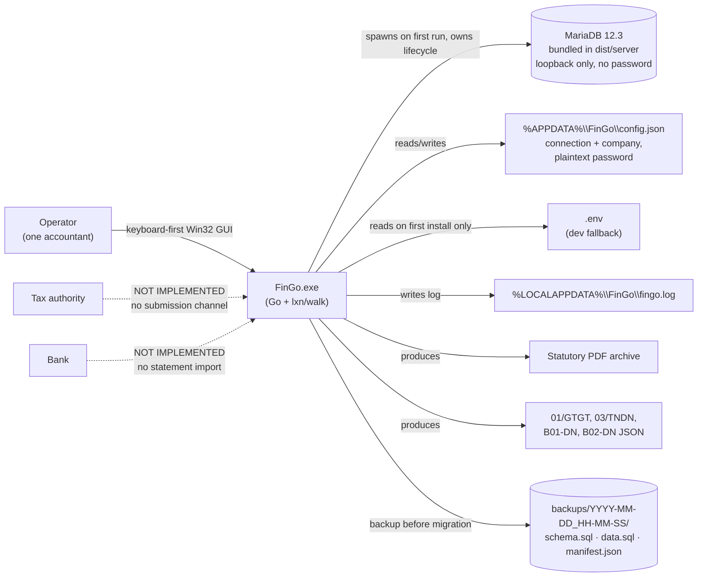
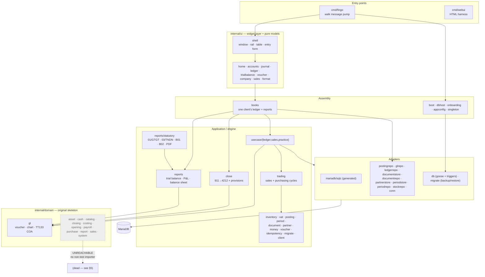
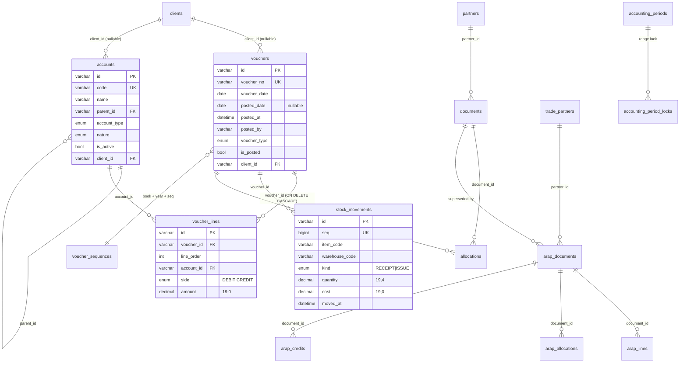
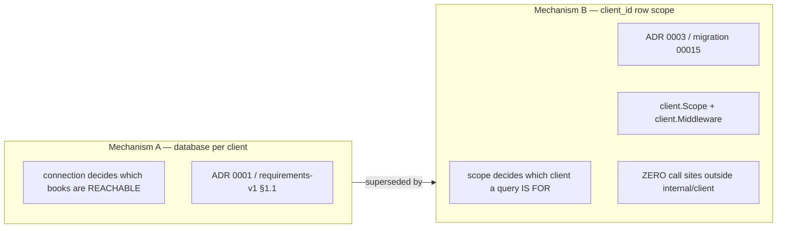
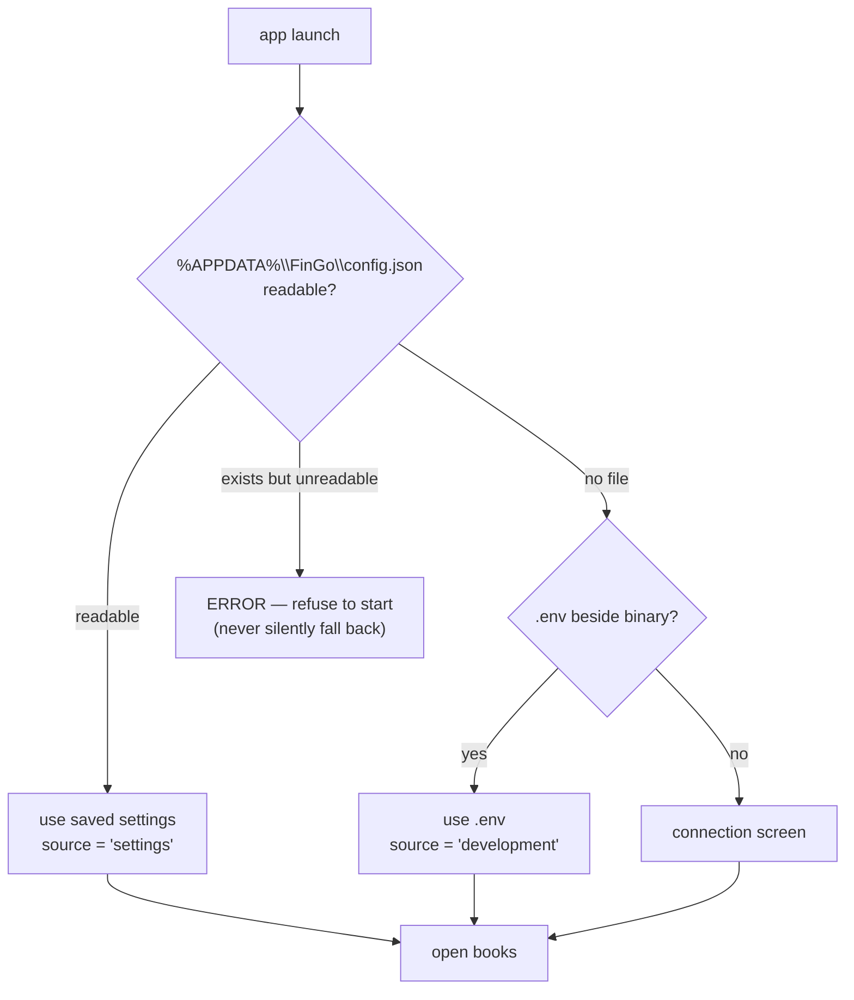

# 03 — Architecture and Data

## 1. Architecture style

**Onion architecture inside a modular monolith, shipped as a single Windows desktop binary.** Domain logic is Go; the database is a locally bundled MariaDB; the UI is a thin Win32 widget layer over toolkit-free presentation models. There are **no stored procedures, no views, and no business logic in SQL**; the database carries data, constraints, and 12 immutability triggers. [HIGH]

The project calls this "Onion Architecture (Modular Monolith)" in `GEMINI.md:50-54`, with the layering:

```
cmd/fingo  →  internal/ui/* (walk widgets)  →  presentation models (pure)
           →  internal/books (assembly)
           →  internal/usecase/*  →  internal/{trading,close,reports,...}  →  internal/domain/*
           →  internal/adapter/mariadb/*  (sqlc + hand-written stores)
           →  MariaDB (bundled, per-client schema)
```

### 1.1 Context diagram



### 1.2 Layered package diagram (what actually exists)



## 2. Component / dependency reality

There are **two generations of packages** with overlapping meaning, and the project says so itself (`GEMINI.md:96-111`):

| Concept | Engine generation (`internal/`) | Older skeleton (`internal/domain/`) | Which one is live |
| :--- | :--- | :--- | :--- |
| Money | `money` — int64 minor units + `Currency` | `money` — decimal đồng | both reachable (`trading` vs `gl`) |
| Partner | `partner` — `trade_partners` (00013) | `partner` — `partners` (00008) | old one is what `voucher_lines.partner_id` and `usecase/practice` use |
| Document | `document` — `arap_*` (00014) | `document` — `documents`/`allocations` (00009) | both; `record_sale` writes the old one |
| Inventory | `inventory` — integer unit average + COGS | `inventory` — exact total value | engine one is live |
| Period | `period` — date ranges, irreversible lock | `gl.Periods` — closed (year, month) | both |
| Period close | `close` — P&L→911→4212 + lock | `domain/closing` — net profit only | engine `close` |
| Reports | `reports` — computed from posted lines | `domain/report` — hand-filled rows, no reader | engine `reports` |

[HIGH — `GEMINI.md:100-111`; verified by import analysis below]

### Where business logic lives

| Concern | Lives in | Evidence | Confidence |
| :--- | :--- | :--- | :--- |
| Double-entry rules, posting gate, reversal | **Go domain** (`internal/domain/gl`) | `gl.go`; ADR 0002 | HIGH |
| VAT arithmetic and rates | **Go** (`internal/vat`, basis points) | `vat.go:147-180` | HIGH |
| Inventory valuation and COGS | **Go** (`internal/inventory`) | `valuation.go`, `cogs.go` | HIGH |
| Sales/purchase flows | **Go** (`internal/trading`) | `sales.go` (799), `purchase.go` (1,019) | HIGH |
| Closing and provisions | **Go** (`internal/close`) | `close.go` (656), `provisions.go` (768) | HIGH |
| Report arithmetic | **Go** (`internal/reports`) | `trialbalance.go`, `profitandloss.go`, `balancesheet.go` | HIGH |
| Immutability of posted data | **Domain + database triggers** | `gl.Post`; `db/triggers/10..22,30..32,40..41,50..51` | HIGH |
| Referential integrity | **Database FKs** | migrations 00001–00015 | HIGH |
| UI formatting rules | **Go presentation models** (`internal/ui/*`) | e.g. `internal/ui/format/money.go`; `docs/plan-native-shell.md:43-52` | HIGH |
| Stored procedures / views / jobs / sequences | **None** | `[NOT FOUND]` in `db/migrations` and `db/triggers` (only `CREATE TRIGGER`); `AUTO_INCREMENT` used for `stock_movements.seq` | HIGH |

### Import closure — measured, not assumed

Transitive `fingo/...` imports from `cmd/fingo` reach **42 packages**. The following **30 packages with code are unreachable from the shipped binary** (tests may still use them): [HIGH — static import analysis]

```
internal/adapter/mariadb/documentstore      internal/domain/gl/gltest
internal/adapter/mariadb/partnerstore       internal/domain/opening
internal/adapter/mariadb/testsupport        internal/domain/payroll
internal/adapter/mariadb/voucherstore       internal/domain/purchase
internal/client                             internal/domain/report
internal/domain/asset                       internal/domain/sales
internal/domain/cash                        internal/domain/system
internal/domain/catalog                     internal/idempotency
internal/domain/closing                     internal/inventory
internal/domain/costing                     internal/migrate
internal/domain/opening                     internal/partner
internal/domain/payroll                     internal/posting
internal/domain/purchase                    internal/reports/statutory
internal/domain/report                      internal/trading
internal/domain/sales                       internal/ui/sales
internal/domain/system                      internal/vat
internal/idempotency                        internal/voucher
internal/inventory                          pkg/logger
internal/migrate                            web · web/books
```

Note the important consequence: **`internal/trading`, `internal/vat`, `internal/posting`, `internal/reports/statutory` and `internal/migrate` are all unreachable from the binary.** The sales/purchase cycles the docs describe as "built" are built and tested, but not reachable by an operator. This is the project's own "unwired" claim, now measured. [HIGH]

## 3. Startup sequence

```mermaid
sequenceDiagram
    participant U as Operator
    participant M as cmd/fingo
    participant S as singleton
    participant B as boot.Ensure
    participant H as dbhost.Supervisor
    participant D as MariaDB (bundled)
    participant K as books + practice.Client
    participant G as walk shell

    U->>M: launch
    M->>M: resolve install root (%LOCALAPPDATA%\FinGo) + log to fingo.log
    M->>S: Acquire(name from install root)
    alt already running
        S-->>M: refuse
        M-->>U: "FinGo is already open"
    end
    M->>B: Ensure(ctx)
    B->>H: DataDirectoryExists? else CreateDataDirectory
    B->>H: StartServer
    H->>D: spawn mariadbd, wait for port AND process liveness
    B->>H: DatabaseExists? else CreateDatabase
    B->>D: db.Up (goose migrations + re-apply triggers)
    B->>D: ChartExists? else SeedChart (TT133, 123 accounts)
    M->>K: books.Open(cfg, database)
    M->>K: openTheYear() if no period
    M->>G: shell.New(); rail + header + status
    M->>G: open "today" screen on a worker goroutine
    G-->>U: window
```

Evidence: `cmd/fingo/main.go:250-320,470-640`; `internal/boot/boot.go:62-104`; `internal/boot/live.go:26-28,253`; `internal/dbhost/dbhost.go:178`; `docs/plan-native-shell.md:232-251`.

## 4. Data

### 4.1 Schema overview

19 tables, created by 15 numbered migrations (versions `00001`–`00015`, with **`00006` absent** — a migration was removed at some point (the abandoned branch still uses a `00006` for a different table set)). Engine: InnoDB, `utf8mb4_unicode_ci`. [HIGH]

| Table | Purpose | Migration |
| :--- | :--- | :--- |
| `accounts` | Chart of accounts: hierarchical, `account_type`, `nature` (DEBIT/CREDIT/DUAL), `is_active` | 00001; reshaped in 00002 |
| `accounting_periods` | (id, name, start_date, end_date, is_closed) | 00001 |
| `vouchers` | Voucher header: `voucher_no`, `voucher_date`, `posted_date`, `posted_at`, `posted_by`, `created_by`, `voucher_type`, `is_posted` | 00001, 00003 |
| `voucher_lines` | **One account, one side, one amount** (`account_id`, `side`, `amount DECIMAL(19,0)`, `line_order`) | 00001 → **reshaped by 00002** |
| `voucher_sequences` | Per-book/year numbering, `UNIQUE(book, fiscal_year, seq)` | 00005 |
| `voucher_series` | Prefix → series per fiscal year, `UNIQUE(prefix, fiscal_year)` | 00012 |
| `idempotency_keys` | Record-and-replay for writes | 00007 |
| `partners` | Older master data (customer/supplier), `UNIQUE(code)`, `UNIQUE(tax_code)` | 00008 |
| `documents` / `allocations` | Older AR/AP documents and settlements | 00009 |
| `stock_movements` | Movement log only; balance is replayed, never stored; `UNIQUE(seq)`, index `(item, warehouse, seq)` | 00010 |
| `inventory_policies` | Valuation method **per fiscal year** (TT133 consistency requirement) | 00010 |
| `accounting_period_locks` | Irreversible date-range locks | 00011 |
| `trade_partners` | Newer master data; duplicate `tax_id` is deliberately **not** unique (it is a warning) | 00013 |
| `arap_documents` / `arap_lines` / `arap_allocations` / `arap_credits` | Newer AR/AP, with stored `Allocated`/`Status` | 00014 |
| `clients` | Practice registry (id, name, tax_id, created_at, active), `UNIQUE(tax_id)` | 00015 |

**18 tables carry a nullable `client_id` with FK to `clients(id)`** (00015 applies 36 `ALTER`s; 18 tables). [HIGH]

### 4.2 Entity-relationship model (core)



### 4.3 Constraints, indexes, and gaps

| Aspect | State | Evidence | Confidence |
| :--- | :--- | :--- | :--- |
| Primary keys | UUID `VARCHAR(36)` everywhere (application-generated) | all migrations | HIGH |
| Uniqueness | `accounts.code`; `vouchers.voucher_no`; `voucher_sequences(book,year,seq)`; `voucher_series(prefix,year)`; `partners(code)`,`partners(tax_code)`; `clients(tax_id)`; `stock_movements(seq)`; `arap_allocations(document,payment)` | migrations | HIGH |
| Amount precision | `DECIMAL(19,0)` for VND after 00002; `DECIMAL(19,4)` for quantities | `00002`, `00010` | HIGH |
| Indexes on read paths | `(item_code, warehouse_code, seq)`; FKs create client-read indexes | `00010:33`; ADR 0003 | HIGH |
| Missing index | no explicit index on `vouchers(voucher_date)` or `voucher_lines(voucher_id, line_order)` beyond FKs | `[NOT FOUND]`; `docs/accounting-review.md:130` still open | MEDIUM |
| `client_id` nullability | **nullable on purpose**: pre-existing rows cannot know their owner; scoped repos *adopt* NULL and *refuse* foreign | `docs/adr/0003-client-data-boundary.md:69-79` | HIGH |
| Composite natural keys | **Deferred** — global unique keys are unchanged, so two clients in one schema collide on `accounts.code` | ADR 0003 "Not decided here" | HIGH |
| Audit log table | **none** — only `created_by/posted_by/posted_at` columns | `00003` | HIGH |
| Users/roles table | **none** — `users` never created | `00003` header comment says so explicitly | HIGH |
| Views / stored procedures / scheduled jobs | **none** | `[NOT FOUND]` | HIGH |
| Seed/reference data | Chart of accounts is seeded **from Go**, not SQL (`gl.TT133Chart()` → 123 accounts); VAT rates are **in-memory only, no table** | `internal/domain/gl/coa_tt133.go`; `GEMINI.md:119` | HIGH |

### 4.4 Migration approach — and its central defect

Two independent migration runners coexist and know nothing about each other: [HIGH — `GEMINI.md:116`]

| Runner | Owner | Bookkeeping table | Applies | Trigger re-apply |
| :--- | :--- | :--- | :--- | :--- |
| `db.Up` | `fingo/db` | `goose_db_version` | `db/migrations/*.sql` (goose format) | yes, `db/triggers/*.sql` every open |
| `internal/migrate.Runner` | `internal/migrate` | `schema_migrations` | numbered `.sql` read by `migrate.Load`, with backup + verify + batch rollback | n/a |

`internal/migrate` is **unreachable from the binary** (see §2). It is the more careful runner (backup-before-apply, verify, restore on failure), and nothing uses it. The binary uses the goose runner. [HIGH]

Triggers are deliberately **not** versioned because sqlc's MySQL parser cannot read `CREATE TRIGGER` (`db/migrate.go:41-52`). Consequence: they are re-applied on every open — idempotent by `CREATE OR REPLACE`, and self-healing if dropped. [HIGH]

### 4.5 Multi-tenant model — two mechanisms, unresolved



ADR 0003 explicitly supersedes ADR 0001's tenant clause and `requirements-v1.md §1.1`. The schema now has both. **No repository accepts a `Scope`**: `client.Scope` appears in no file outside `internal/client` (verified by grep). [HIGH]

## 5. Authentication, authorization, session

| Concern | State | Evidence |
| :--- | :--- | :--- |
| Login / password verification | **None.** No bcrypt/argon2 import, no session, no user table. | `[NOT FOUND]`; `cmd/fingo/main.go:136-140` states "there is no login" |
| Identity used for attribution | Windows `%USERNAME%`, falling back to `"ketoan"` | `cmd/fingo/main.go:141-147` |
| Authorization / roles / permissions | **None enforced.** Types exist in `internal/domain/system` (roles, `Permission.Action`), which is unreachable | `docs/accounting-review.md:100-101`; §5 import closure |
| Segregation of duties | **None** | same |
| Client boundary enforcement | `client.Middleware` exists (401/403 + scope on context) and is **never mounted** | `internal/client/middleware.go`; ADR 0003 |
| Session handling | n/a — single-process desktop app | `docs/requirements-v1.md:68` |
| Database credentials | bundled server binds loopback, **no password**; external DB has a plaintext password in `config.json` | `internal/boot/live.go:26-28`; ADR 0005 |

Assessment: the security model is **"the Windows account is the security boundary"**. That is coherent for the stated deployment (single operator, machine they control) and indefensible for the stated *business* (an accounting practice holding client books, where book 2 of 50 must not be reachable from book 1). [INFERRED, HIGH confidence in the inconsistency]

## 6. Configuration model



| Key / field | Where | Notes |
| :--- | :--- | :--- |
| `host`, `port`, `user`, `password`, `database`, `params` | `%APPDATA%\FinGo\config.json` | structured fields, **not** a DSN; built via `mysql.Config` so `@ : / \` survive |
| `DB_HOST/PORT/USER/PASSWORD/NAME/DRIVER/PARAMS` | `fingo/.env` | dev fallback; `DB_DRIVER` is **dead config** (read by nothing) — ADR 0005 |
| `DB_PARAMS` | `fingo/.env` | must pin `loc=UTC`; the comment records a real bug where a period ending 12-31 read back as 12-30 |
| Company name, tax code | saved settings | collected on first run |
| `FINGO_ROOT` | environment | moves install root |
| Feature flags | **none** | `[NOT FOUND]` |

## 7. External dependencies and their risk

| Dependency | Version | Licence | Risk | Confidence |
| :--- | :--- | :--- | :--- | :--- |
| `github.com/lxn/walk` | `v0.0.0-20210112085537` | BSD-3 (per upstream) | **High**: dormant since 2021-01-12, no accessibility bridge, only Win32-native Go toolkit | HIGH — `docs/plan-native-shell.md:348` |
| `github.com/lxn/win` | `v0.0.0-20210218163916` | BSD-3 | High: same maintenance status; indirect via walk | MEDIUM |
| `github.com/go-sql-driver/mysql` | v1.10.1 | MPL-2.0 | Low | HIGH |
| `github.com/pressly/goose/v3` | v3.28.0 | MIT | Low; but goose holds package-level state, so `db.Up` is not concurrency-safe | HIGH — `db/migrate.go:23-26` |
| `github.com/shopspring/decimal` | v1.4.0 | MIT | Low | HIGH |
| `github.com/google/uuid` | v1.6.0 | BSD-3 | Low | HIGH |
| `golang.org/x/{sys,text,sync}` | 0.47/0.41/0.22 | BSD-3 | Low | HIGH |
| `gopkg.in/Knetic/govaluate.v3` | v3.0.0 | MIT | Low-medium: unmaintained, pulled by walk | MEDIUM `[INFERRED]` |
| MariaDB server (bundled binaries) | 12.3.x | GPLv2 | **Medium-high**: GPL redistribution obligations for a shipped product; 36–47 MB bundle; antivirus/port issues | HIGH for size/version; MEDIUM for licensing consequence `[INFERRED]` |
| `htmx.min.js` (vendored) | unversioned | BSD-2 (per upstream) | Low; only used by the demoted HTML harness | HIGH — `fingo/web/static/htmx.min.js` |

**No PDF library, no Excel library, no HTTP client SDK** — the PDF writer is hand-rolled (`internal/reports/statutory/pdf.go`) and Vietnamese is transliterated because standard PDF fonts carry no Vietnamese glyphs. [HIGH]

## 8. Architecture findings

| ID | Finding | Severity | Evidence |
| :--- | :--- | :--- | :--- |
| ARC-1 | Two generations of domain packages coexist; five concepts are duplicated with **opposite** semantics (notably inventory rounding and period close). | High | `GEMINI.md:100-111`; §2 table |
| ARC-2 | 30 packages, including the whole sales/purchase/statutory engine, are unreachable from the shipped binary. | High | §2 import closure |
| ARC-3 | Two migration runners with different bookkeeping tables; the safer one (`internal/migrate`) is dead code. | High | §4.4 |
| ARC-4 | Two tenant mechanisms (database-per-client **and** `client_id`) are both present; neither is enforced at the repository layer. | High | §4.5 |
| ARC-5 | No authentication or authorization at all, in a system designed to hold many clients' books. | Critical | §5 |
| ARC-6 | UI `Available` map is the real product boundary, and it is a hard-coded literal in `main` (`openable{...}`), so "what is implemented" has no single source of truth. | Medium | `cmd/fingo/main.go:426` |
| ARC-7 | Chart of accounts is seeded from Go rather than a migration, so schema and reference data have different version histories. | Medium | `internal/domain/gl/coa_tt133.go`; `internal/boot` |
| ARC-8 | Database triggers are outside the migration system, re-applied on every open; a syntax error in a trigger body breaks startup, not a migration. | Medium | `db/migrate.go:41-70` |
